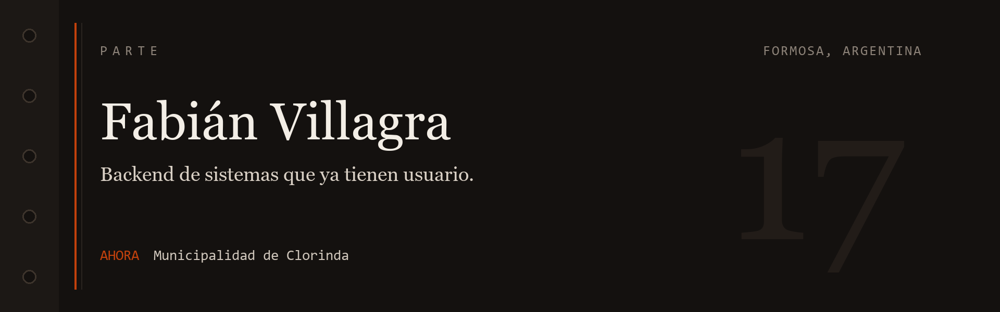

Soy Fabián Villagra. Vivo en Formosa y trabajo el backend de sistemas que ya tienen usuarios.

En la Municipalidad de Clorinda eso es el inventario de suministros, la app donde el vecino consulta y paga tributos, y el sistema de recursos humanos del personal. Los servicios corren en Ubuntu, dentro de Docker.

Antes armé la API de una plataforma de recursos humanos, el servidor de una academia de estadística con un tutor de OpenAI, y el backend de una app de taxis con el auto en el mapa.

El recorrido completo está en el [portfolio](https://portfolio-fabian-villagra.netlify.app/).

## En uso

### Municipalidad de Clorinda

agosto 2025 — hoy

Control de suministros y compras públicas. Autogestión ciudadana en Flutter: consulta de tributos, cobro con Mercado Pago y confirmación por webhooks. Recursos humanos para el personal municipal: áreas, contratos, licencias, adicionales y el ingreso de cada día. Cada área tiene un encargado, y es esa persona quien marca el ingreso de su gente. MySQL y SQL Server, según el sistema.

### Kentra

enero — julio 2025 · freelance

API para recursos humanos: organigrama, roles, eventos internos y personal en campo, ubicado con Google Maps.
Sesión con JWT y cookies HTTPOnly. Imágenes en Cloudinary.
La interfaz es React con Redux Toolkit.

### Stats Academy

marzo — diciembre 2024

Backend de una plataforma para enseñar estadística.
Cuentas, roles, evaluaciones con corrección automática y tableros de progreso.
Un tutor por chat con la API de OpenAI, y avisos en vivo por WebSockets.
Versión web y una app móvil.

### tuRemo

abril — diciembre 2023

Pedido de taxis con geolocalización.
El pasajero elige la empresa, sigue el auto en el mapa y habla con el conductor por chat.
Pasajero y conductor reciben el cambio de estado: asignado, en ruta, finalizado.
Node.js, React, MySQL y Socket.io.

## Por mi cuenta

Pasé los precios de vehículos de ACARA a una base que se puede consultar. Un script en Python lee el ODS, separa marca, modelo y versión, y los guarda en MySQL. Encima hay una API para pedir esa valuación.

[acara-precios-mysql](https://github.com/Fabian-17/acara-precios-mysql) · [ApiAcara](https://github.com/Fabian-17/ApiAcara)

## Herramientas

- **Lenguajes.** TypeScript, JavaScript, Python
- **Servidor.** Node.js, Express, NestJS, FastAPI, Socket.io
- **Cliente.** React, React Native, Redux Toolkit
- **Datos.** MySQL, PostgreSQL, SQL Server, MongoDB
- **Publicación.** Docker, Ubuntu, Git
- **Integraciones.** JWT, Mercado Pago, OpenAI, Google Maps, Cloudinary

## Formación

Tecnicatura en Desarrollo de Software Multiplataforma, Instituto Politécnico Formosa (2023–2024).

## Para escribirme

Trabajo remoto desde Formosa.

[Portfolio](https://portfolio-fabian-villagra.netlify.app/) · [LinkedIn](https://www.linkedin.com/in/carlos-fabián-villagra-35b1b8275/) · [Email](mailto:fabianvillagra28@gmail.com) · [WhatsApp](https://wa.me/543718554320)